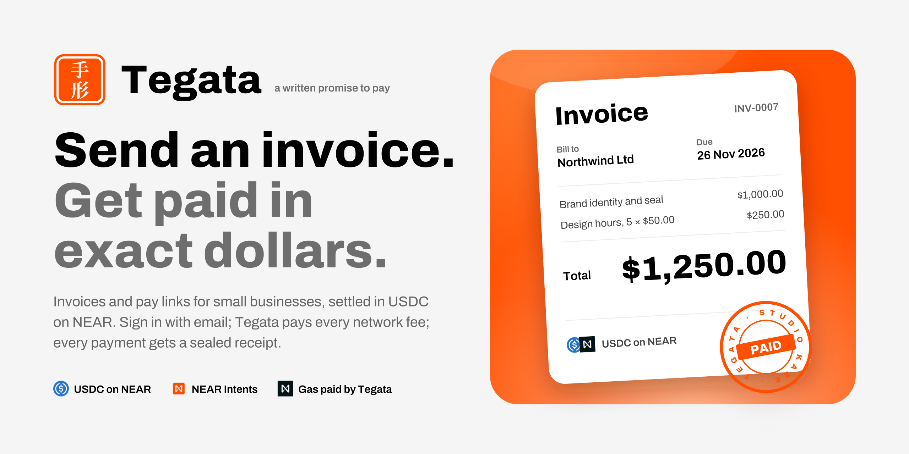
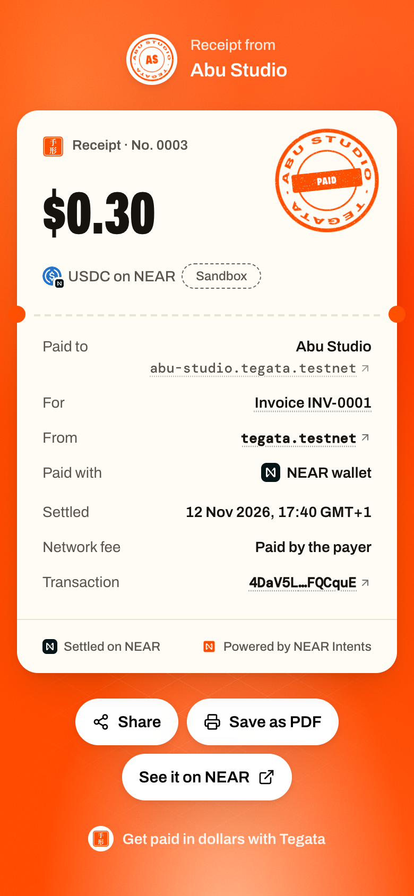
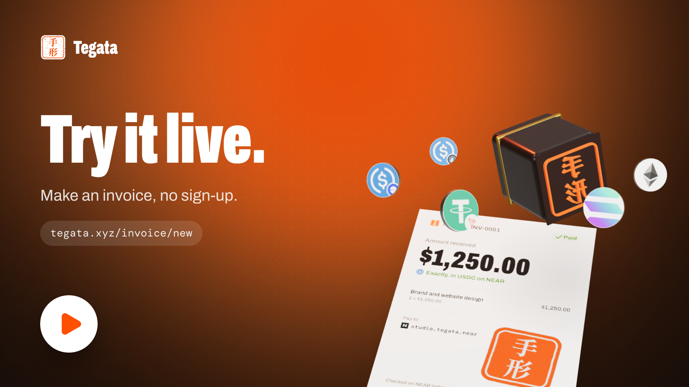
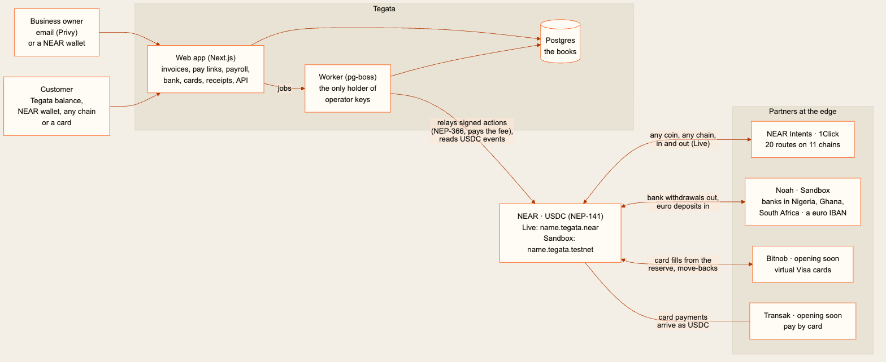
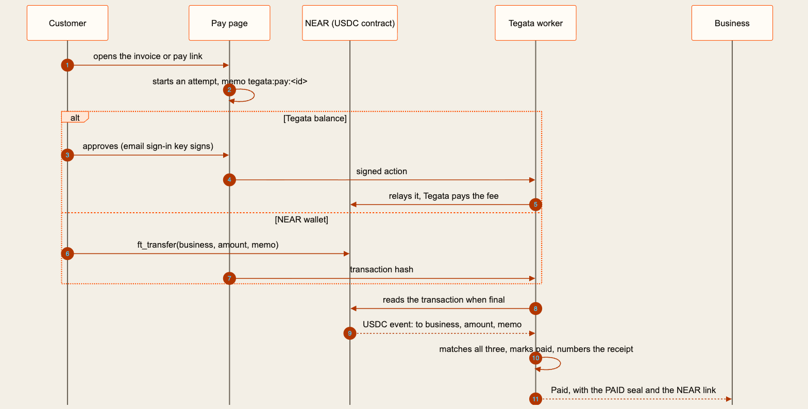

<p align="center">
  <a href="https://tegata.xyz">
    <picture>
      <source media="(prefers-color-scheme: dark)" srcset=".github/assets/banner-dark.png">
      
    </picture>
  </a>
</p>

<h1 align="center">Tegata · 手形</h1>

<p align="center"><b>Get paid. Pay your team. In exact dollars.</b></p>

<p align="center">
  <b><a href="https://tegata.xyz">Open the app</a></b> ·
  <b><a href="#demo">Demo</a></b> ·
  <b><a href="https://docs.tegata.xyz">Docs</a></b> ·
  <b><a href="#proof-on-near">Proof on NEAR</a></b>
</p>

Tegata is the money account for a small business, settled in USDC on NEAR. The owner signs in with an email; Tegata
opens a NEAR account named after the business and pays every network fee with meta transactions, so nobody buys
NEAR or keeps a wallet. **Getting paid:** invoices, pay links, a counter and a checkout API, paid from a Tegata
balance, any NEAR wallet, a coin on another chain (USDT on Tron, BTC, SOL, USDC on Base… through NEAR Intents) or a
bank card, and the business always receives exactly what it billed. **Paying out:** one approval pays a whole
payroll in one all-or-nothing transaction, to each person's Tegata account, NEAR account or address on another
chain; Send pays anyone anywhere; Bank withdraws to a bank account in naira, cedi or rand; Cards gives the owner and
the team virtual Visa cards filled from the balance. A payment counts as paid only when NEAR's own USDC record shows
it; then the business's seal stamps a numbered receipt that links to the transaction. Activity, a CSV, a monthly
statement and a check of the books against NEAR are there for the accountant.

Built for **NEAR HACKATHON · Real-World Money** ([how it meets the track](#how-tegata-meets-the-hackathon)).
手形 (_tegata_) is the old Japanese bill of exchange: a written promise to pay, sealed by whoever issues it.

## The problem

A small design studio finishes a job for a client abroad and sends an invoice for $1,250.00. Getting that money
in is slow or expensive:

- **By card**, [Stripe's](https://stripe.com/pricing) published price (checked 12 Nov 2026) is 2.9% + 30¢, plus 1.5% for an
  international card and 1% when the currency is converted: about $68 of the $1,250.
- **By wire**, receiving US dollars into a [Wise Business](https://wise.com/us/pricing/business/receive) account
  costs $6.11, before whatever the client's bank charges to send it.
- **In stablecoins**, the client may already hold digital dollars that move in minutes for under a cent. But to
  take them today, the studio has to:
  1. ask which coin and which blockchain the client holds;
  2. send a wallet address for exactly that chain, and hope the client picks the right network;
  3. watch the wallet and match each incoming transfer to an invoice by its amount;
  4. buy that chain's own token before the money can move again.

If the client holds the wrong coin, someone swaps it by hand, and $1,250.00 arrives as something less, with a
transaction hash instead of a receipt. Paying the studio's own people is the same problem backwards: each one wants
their pay somewhere different, and most of them want it in their local bank.

## The idea

Tegata makes the stablecoin route as plain as sending an invoice. The studio signs in with its email, and Tegata
opens `studio.tegata.near` on NEAR (`.tegata.testnet` in the Sandbox): no wallet, no seed phrase, no NEAR to buy,
because Tegata pays every network fee. The studio sends the invoice. The client opens the link and pays the way they
can: from USDC they hold on NEAR, from a coin on another chain (NEAR Intents converts it so exactly $1,250.00
arrives), or with a card. The invoice turns Paid when NEAR itself shows the transfer, the studio's seal is stamped on
it, and both sides can open a numbered receipt with the NEAR transaction. On payday one approval pays everyone,
wherever each of them chose.

The studio's job becomes: send the invoice, watch it turn Paid, approve payroll.

### A real one

INV-0001 from Abu Studio, for $0.50 of test USDC with part-payments allowed, paid on the NEAR-wallet rail by `tegata.testnet`
(Tegata's operator, using `pnpm ops pay-link`):

1. $0.20 arrived and the invoice turned **Partly paid**
   ([transaction](https://testnet.nearblocks.io/txns/2q3MP2dbT2sMV5EXX6KpD9d4YUCMprcEKmjZXyWz8cVj)).
2. An attempt to pay $0.40 was refused: "The most left to pay is $0.30".
3. $0.30 arrived, the invoice turned **Paid**, the seal was stamped, and receipt No. 0003 was issued
   ([transaction](https://testnet.nearblocks.io/txns/4DaV5LVezTYavbjzQdfsSUcMYL1Yiz59z5Z4TyFQCquE)).

<p align="center">
  
</p>

### Try it on the live Sandbox

The Sandbox is the whole app on NEAR testnet with test USDC, and it's free. You need two email addresses, one for
the business and one for its customer (`you+customer@gmail.com` reaches the same Gmail inbox), and two browser
windows: a normal one and a private one.

| #   | Do this                                                                                                                           | See this                                                                                                                        |
| --- | --------------------------------------------------------------------------------------------------------------------------------- | ------------------------------------------------------------------------------------------------------------------------------- |
| 1   | Open [the app](https://tegata.xyz/signin), enter your email, then the six-digit code it sends                                     | The code cells turn vermilion and Tegata's seal presses                                                                         |
| 2   | Name your business, pick a pay address, press **Open my account**                                                                 | `your-name.tegata.testnet` is created on NEAR and registered for USDC while you watch, then your business's own seal is stamped |
| 3   | Open **Invoices**, press **New invoice**. Add a customer and one item for $1.00, press **Review and send**, then **Send invoice** | The invoice gets its number (INV-0001) and a link. Press **Copy link**                                                          |
| 4   | Open the link in the private window                                                                                               | The invoice as your customer sees it: items, total, a PDF, and **Pay $1.00**                                                    |
| 5   | Press **Pay $1.00**, choose **Tegata balance**, and sign in with the second email; name its business and open its account         | The pay page comes back, signed in as the customer                                                                              |
| 6   | Press **Add $5.00 test dollars**                                                                                                  | 5 test USDC arrive from Tegata's Sandbox stash                                                                                  |
| 7   | Press and hold **Hold to pay $1.00**                                                                                              | Live steps, then your business's seal stamps PAID. **View your receipt** opens receipt No. 0001 with its NEAR transaction       |
| 8   | Back in the first window, open the invoice                                                                                        | **Paid**, the payment on its timeline, and on Home the new balance with the payment under Latest                                |

If **Add test dollars** says "The Sandbox stash is empty right now", get 20 test USDC from [Circle's faucet](https://faucet.circle.com):
choose NEAR Testnet, paste the customer's pay address, then hold to pay.

**Live** is the same app on NEAR mainnet with real dollars: switch **Sandbox → Live** at the top, open your Live
account (`your-name.tegata.near`), and a pay link's **Another chain** option gives a real deposit address for USDT,
USDC, BTC, ETH or SOL on their own chains. Only use money you mean to move.

## Demo

<p align="center">
  <a href="https://tegata.xyz/invoice/new">
    
  </a>
</p>

The cover opens the live app where a first visit should start: build an invoice without an account, then sign in
to send it. To follow a payment all the way to the PAID seal, use the eight steps in
[Try it](#try-it-on-the-live-sandbox).

## How it works

<p align="center">
  <a href="https://docs.tegata.xyz/docs/how-money-moves">
    <picture>
      <source media="(prefers-color-scheme: dark)" srcset=".github/assets/system-dark.png">
      
    </picture>
  </a>
</p>

<p align="center"><a href="https://docs.tegata.xyz/docs/how-money-moves">Open the detailed map</a> · <a href=".github/diagrams/readme-system.mmd">Edit the Mermaid source</a></p>

There are three parts. The **web app** (Next.js) serves the landing page, the app, the public invoice, pay and
receipt pages, and the API. The **worker** runs every slow or risky job: it relays signed actions to NEAR, settles
payments, follows NEAR Intents swaps to delivery, pays payroll and referral rewards, issues repeat invoices, hands
bank payouts and card fills to the partners, and sends the emails from an outbox written with each event. It is the
only process that holds the operator's keys; the web server never does. **Postgres** keeps the books.

<p align="center">
  <a href="https://docs.tegata.xyz/docs/how-money-moves">
    <picture>
      <source media="(prefers-color-scheme: dark)" srcset=".github/assets/payment-dark.png">
      
    </picture>
  </a>
</p>

<p align="center"><a href="https://docs.tegata.xyz/docs/how-money-moves">Open the detailed map</a> · <a href=".github/diagrams/readme-payment.mmd">Edit the Mermaid source</a></p>

Every payment attempt carries its own memo, `tegata:pay:<id>`. Nothing the payer's browser says is believed: the
worker waits until the transaction is final on NEAR, reads the USDC contract's own transfer event, and marks the
attempt paid only if the receiver is the business, the amount covers what is due, and the memo is this attempt's.
A payment from another chain is a signed NEAR Intents quote with its own deposit address, `EXACT_OUTPUT` so the
business receives the exact amount; it counts once NEAR shows the USDC reaching the business. A payroll row paid in
a stablecoin on another chain is `EXACT_OUTPUT` too, so the person receives exactly their pay (the business covers the
conversion, at most 2% or $1), and the row counts as paid only when NEAR Intents reports it delivered; one that comes
back is marked not paid and can be retried. Send and Move out are `EXACT_INPUT`: the business sends exactly what it
approved, and sees what arrives before approving. A signed action is saved before it is sent, so a worker that restarts mid-send re-sends the same bytes and never pays
twice.

### Built on NEAR

| Piece                       | What it does in Tegata                                                                                                                                                                                                                                                                                                          | Where in the code                                                                                       |
| --------------------------- | ------------------------------------------------------------------------------------------------------------------------------------------------------------------------------------------------------------------------------------------------------------------------------------------------------------------------------- | ------------------------------------------------------------------------------------------------------- |
| Named accounts              | Every business gets `name.tegata.near` (Live) or `name.tegata.testnet` (Sandbox), created by Tegata's operator with the owner's own key as its only full-access key                                                                                                                                                             | `packages/core/src/near/accounts.ts`, `operator.ts`                                                     |
| Meta transactions (NEP-366) | The owner signs a delegate action with the key from their email login; the worker relays it and pays the fee, so user accounts hold 0 NEAR. A payroll run is up to 50 USDC transfers in one delegate action: all land or none do                                                                                                | `packages/core/src/near/delegate.ts`, `packages/services/src/relays.ts`, `payroll.ts`, `apps/worker`    |
| USDC on NEAR (NEP-141)      | Every balance, payment, payout and reward. "Paid" is decided by the USDC transfer event, read from the final transaction                                                                                                                                                                                                        | `packages/core/src/near/usdc.ts`, `transfers.ts`, `packages/services/src/payments.ts`                   |
| NEAR Intents (1Click API)   | Paying in from 11 coin-and-chain routes (deposit address, QR, refund address, live status, part-paid top-ups, automatic refunds); paying out to them (Send, payroll rows, refunds to the payer's chain, Balance → Move out); the Gnosis hop that tops up a crypto card; live quotes on the landing calculator                   | `packages/core/src/oneclick`, `packages/services/src/oneclick-payments.ts`, `payouts.ts`, `apps/worker` |
| NEAR Connect                | Customers pay from their own NEAR wallet, and owners can sign in with one (NEP-413) and approve actions as delegate actions the wallet signs, relayed gas-free                                                                                                                                                                  | `apps/web/lib/client/near-wallet.ts`, `near-account.ts`; `packages/core/src/near/wallet.ts`             |
| Privy                       | Email sign-in that gives each owner a NEAR key without a wallet app                                                                                                                                                                                                                                                             | `apps/web/app/providers.tsx`                                                                            |
| Our contract: autopilot     | `pay.tegata.near` (Live) and `pay.tegata.testnet` (Sandbox) hold money a business sets aside and pays its payroll on each payday with nobody online, confirming every row (paid, or returned to the business)                                                                                                                                                         | `contracts/autopilot/src/lib.rs`; 12 tests in `contracts/harness/tests/autopilot.rs`                    |
| Team treasury (Sputnik DAO) | Payroll that needs k of n approvers: a business's money sits in a Sputnik DAO v2 (the contract Trezu runs on, from the shared mainnet code) whose policy needs k of its approvers; each votes with their own key through the relayer, and the vote that reaches k pays every row in one batch. Tegata has no role in the policy | `packages/core/src/near/treasury.ts`, `packages/services/src/team.ts`; `/app/team`, `/app/approvals`    |

USDC contracts: `17208628f84f5d6ad33f0da3bbbeb27ffcb398eac501a31bd6ad2011e36133a1` on mainnet,
`3e2210e1184b45b64c8a434c0a7e7b23cc04ea7eb7a6c3c32520d03d4afcb8af` on testnet. Tegata's operator: `tegata.near`,
`tegata.testnet`.

At the edge, where a licence is needed, the partners are crypto-native and reached from NEAR: **Noah** pays a bank
account in Nigeria, Ghana or South Africa from USDC and gives a business euro bank details whose deposits arrive as
USDC (`packages/core/src/noah`, `packages/services/src/bank.ts`); **Bitnob** issues virtual Visa cards funded with
stablecoins (`packages/core/src/bitnob`, `packages/services/src/issued-cards.ts`); **Transak** sells USDC on NEAR to a
card payer (`packages/core/src/transak`, `packages/services/src/card-payments.ts`).

## How Tegata meets the hackathon

Track 08, Real-World Money: "Bring the boring money onchain". The build asked for: "Build payroll, invoicing,
remittances, merchant payments and stablecoin rails for real businesses. Something a normal company could use
tomorrow." What to lean on: "Stablecoins, NEAR Intents, meta transactions".

| Asked for                                       | How Tegata meets it                                                                                                                                                                                                                                                   | Where to check                                                                                                                                                                                                                                      |
| ----------------------------------------------- | --------------------------------------------------------------------------------------------------------------------------------------------------------------------------------------------------------------------------------------------------------------------- | --------------------------------------------------------------------------------------------------------------------------------------------------------------------------------------------------------------------------------------------------- |
| "invoicing"                                     | Numbered invoices with customers, items, discount, tax and due dates; part-payments, repeat invoices, reminders, a PDF and a timeline                                                                                                                                 | `/app/invoices`; `packages/services/src/invoices.ts`; [INV-0001](#a-real-one)                                                                                                                                                                       |
| "merchant payments"                             | Pay links with a QR; a counter for in-person sales; checkout sessions and signed webhooks for a shop's own site; paid from a Tegata balance, a NEAR wallet, a coin on another chain (Live) or a card                                                                  | `/app/links`, `/app/counter`, `/app/developers`; [pay link](https://testnet.nearblocks.io/txns/4rs3uTXRaCnNCsMepj4tDiTsTZuootKSsW2QzqMkcaQ5), [checkout session](https://testnet.nearblocks.io/txns/6tmnGKULQVyUUeGdpWNQYLNWCrCCmiv4iqQtsimSnBnF)   |
| "payroll"                                       | People added by email or CSV choose where pay lands on their own page (a Tegata account, a NEAR account, or in Live an address on another chain); one approval pays everyone ready in one all-or-nothing transaction, with a payslip each; autopilot pays on schedule | `/app/people`, `/app/payroll`; `packages/services/src/payroll.ts`; [transaction](https://testnet.nearblocks.io/txns/7hEg9DgZdEaq7e4AHtY9FZ4ReB3sveq5XwewiEanCKFr)                                                                                   |
| "remittances"                                   | Send dollars to any NEAR account in one hold, or in Live to an address on another chain in the coin the receiver wants; withdraw to a bank account in Nigeria, Ghana or South Africa (Sandbox, through Noah)                                                          | `/app/send`, `/app/bank`; [transaction](https://testnet.nearblocks.io/txns/4a5U9osgJrXKN5EDT3mvrWGT6NrFXoQXwH4bYZjqH6TX)                                                                                                                            |
| "stablecoin rails", "Stablecoins"               | USDC on NEAR holds every balance and settles every payment, payout, receipt and reward; cards spend it; bank details turn euros into it                                                                                                                               | `packages/config/src/index.ts`; `packages/core/src/near/usdc.ts`                                                                                                                                                                                    |
| "NEAR Intents"                                  | Every payment in from another chain arrives as exactly what was billed; every payout to one is quoted first (payroll in a stablecoin arrives as exactly the pay); refunds go back in the payer's own coin                                                             | `packages/services/src/oneclick-payments.ts`, `payouts.ts`                                                                                                                                                                                          |
| "meta transactions"                             | Every user action is a NEP-366 delegate action relayed by Tegata, signed by the key from an email login or by the owner's own NEAR wallet; user accounts never need NEAR                                                                                              | `packages/core/src/near/delegate.ts`, `wallet.ts`; [transaction](https://testnet.nearblocks.io/txns/8oDoAfrPgHFRKW7jKKGzHmURxmErFTHYLVhByrzp9Bxk), [wallet-signed](https://testnet.nearblocks.io/txns/8PWgsYjeTMFY7WVkgWNBqcSnRwfQqPoAazsNeaFnXRo7) |
| "Something a normal company could use tomorrow" | Email sign-in, dollars only, no wallet; invoices, PDFs, receipts, emails and a monthly statement in the shape a bookkeeper expects                                                                                                                                    | [Try it](#try-it-on-the-live-sandbox); [If you keep the books](#if-you-keep-the-books)                                                                                                                                                              |

The track's example prompt is a starting point, not a requirement. Against its list:

| Example prompt                                                                                                                          | Tegata                                                                                                                                                                                                                                | Where to check                                                                                      |
| --------------------------------------------------------------------------------------------------------------------------------------- | ------------------------------------------------------------------------------------------------------------------------------------------------------------------------------------------------------------------------------------- | --------------------------------------------------------------------------------------------------- |
| "Invoice page with amount, due date, line items and a pay button. Payment goes through the 1Click API."                                 | The public invoice has all four and a sticky Pay button; in Live, **Another chain** is a 1Click deposit address for the exact amount, followed to delivery                                                                            | `/i/<token>`; `apps/web/components/invoices/public-invoice.tsx`, `components/pay/deposit-panel.tsx` |
| "Gasless for the freelancer: route their transactions through a meta transaction relayer that only pays for calls to our own contract." | The relayer sponsors only action lists the server drafted itself (USDC transfers the app asked for, and calls to our autopilot contract). The browser signs; the server re-encodes and requires the exact bytes                       | `packages/services/src/relays.ts`                                                                   |
| "Status updates the freelancer can trust: paid, pending or refunded, with links to the transactions."                                   | A payment on NEAR counts only on its own USDC event (money received another way is marked paid by hand, and its receipt says so); every receipt links its transaction; invoices show Sent, Viewed, Partly paid, Overdue, Paid or Void | `packages/core/src/near/transfers.ts`                                                               |
| "CSV export an accountant could open without asking a single question."                                                                 | Activity exports a month as CSV (date and time in the business's time zone, type, counterparty and account, money in, money out, USD, status, receipt link, NEAR transaction) and as a statement PDF                                  | `/app/activity`; `apps/web/lib/server/books.ts`; `packages/documents/src/statement-pdf.tsx`         |
| "Write the README first as if a bookkeeper will read it."                                                                               | This README was written before the code and grew with it                                                                                                                                                                              | [If you keep the books](#if-you-keep-the-books)                                                     |

Judging, in the organiser's words: "Claude Code & Codex screen every project first: they check that it runs and
does what the README says. … Previous NEAR hackathons evaluated technical implementation, design, impact,
originality and sustainability."

| Criterion                          | Tegata                                                                                                                                                                                                                                                                                                                                                                                                                                                                  | Where to check                                                                                              |
| ---------------------------------- | ----------------------------------------------------------------------------------------------------------------------------------------------------------------------------------------------------------------------------------------------------------------------------------------------------------------------------------------------------------------------------------------------------------------------------------------------------------------------- | ----------------------------------------------------------------------------------------------------------- |
| Runs and does what the README says | Every row of Try it runs on the live Sandbox; every claim below has a transaction or a script                                                                                                                                                                                                                                                                                                                                                                           | [Try it](#try-it-on-the-live-sandbox); [Proof on NEAR](#proof-on-near)                                      |
| Technical implementation           | A relayer that lands each action exactly once, even after a crash mid-send; payments decided by NEAR's own USDC event; signed and verified NEAR Intents quotes; invoice and receipt numbers that can't collide; an email outbox written inside each event's transaction                                                                                                                                                                                                 | `packages/services/src/proofs/recover.ts`; `packages/core/src/near/operator.ts`; `apps/worker/src/index.ts` |
| Design                             | One system in washi and sumi (warm paper by day, warm ink at night): a 3D seal on the landing that presses a bill, and in sign-up cuts the business's own round seal as its name is typed; that seal stamps its invoices and receipts; a vermilion stage for money moments and a lacquer stage for the big surfaces; real chain, coin, card, country and bank logos; money in its own currency; motion and sound; light and dark; payer pages designed for phones first | [`/dev`](https://tegata.xyz/dev) shows every part in every state                                            |
| Impact                             | A $1,250 card payment from abroad costs the business about $68; with Tegata it receives the full $1,250 from whatever coin the client holds, and pays its team wherever each person wants                                                                                                                                                                                                                                                                               | [The problem](#the-problem); [Try it](#try-it-on-the-live-sandbox)                                          |
| Originality                        | A generated seal per business as the PAID stamp; readable NEAR pay addresses; one approval that pays a team on several chains at once; referrals that pay only when money arrives from real customers                                                                                                                                                                                                                                                                   | `apps/web/components/brand/seal.tsx`; `packages/services/src/payroll.ts`; `referrals.ts`                    |
| Sustainability                     | About 0.0003 NEAR in fees per relayed action and about 0.008 NEAR per new account, measured and paid by Tegata; one small server and Postgres; MIT licensed                                                                                                                                                                                                                                                                                                             | [Proof on NEAR](#proof-on-near)                                                                             |

## Proof on NEAR

Recorded on NEAR testnet. Every one opens on the explorer. The explorer's pages refuse scripts (403); a script or
an agent can read any of them from its API instead: `curl https://api-testnet.nearblocks.io/v1/txns/<hash>`.

| What happened                                                                                                                                                                                                                                                            | Transaction                                                                                                                                                                                                                                                                                                                                                                    |
| ------------------------------------------------------------------------------------------------------------------------------------------------------------------------------------------------------------------------------------------------------------------------ | ------------------------------------------------------------------------------------------------------------------------------------------------------------------------------------------------------------------------------------------------------------------------------------------------------------------------------------------------------------------------------ |
| An account holding 0 NEAR moved a token (0.001 wNEAR on `wrap.testnet`); Tegata's operator paid 0.00029 NEAR in fees                                                                                                                                                     | [8oDoAf…](https://testnet.nearblocks.io/txns/8oDoAfrPgHFRKW7jKKGzHmURxmErFTHYLVhByrzp9Bxk)                                                                                                                                                                                                                                                                                     |
| `abu-studio.tegata.testnet` sent 1.00 test USDC from the app; it still holds 0 NEAR                                                                                                                                                                                      | [4a5U9o…](https://testnet.nearblocks.io/txns/4a5U9osgJrXKN5EDT3mvrWGT6NrFXoQXwH4bYZjqH6TX)                                                                                                                                                                                                                                                                                     |
| A pay link for 0.25 was paid on the NEAR-wallet rail by `tegata.testnet` (`pnpm ops pay-link`) and marked paid from the USDC event                                                                                                                                       | [4rs3uT…](https://testnet.nearblocks.io/txns/4rs3uTXRaCnNCsMepj4tDiTsTZuootKSsW2QzqMkcaQ5)                                                                                                                                                                                                                                                                                     |
| INV-0001 was paid 0.20, then 0.30, the same way; a 0.40 attempt in between was refused                                                                                                                                                                                   | [2q3MP2…](https://testnet.nearblocks.io/txns/2q3MP2dbT2sMV5EXX6KpD9d4YUCMprcEKmjZXyWz8cVj), [4DaV5L…](https://testnet.nearblocks.io/txns/4DaV5LVezTYavbjzQdfsSUcMYL1Yiz59z5Z4TyFQCquE)                                                                                                                                                                                         |
| Referral: a payment from an account the inviting business had sent money to; it didn't count                                                                                                                                                                             | [8DY4Wa…](https://testnet.nearblocks.io/txns/8DY4WakUkhYHLPLsGd9rM2Y6dVgAL4YDFVa32XZSQauZ)                                                                                                                                                                                                                                                                                     |
| Referral: a fresh customer account (made by the proof script and funded by Tegata's operator, never by either business) paid the invited business 5.00, which qualified the invite                                                                                       | [5rdLsx…](https://testnet.nearblocks.io/txns/5rdLsxc1kMucKP2phfen3M5wwTgetLHYcg3u1fjPZqWs)                                                                                                                                                                                                                                                                                     |
| Referral: 1.00 reward to the business that invited, after the 10-minute hold                                                                                                                                                                                             | [GPweE9…](https://testnet.nearblocks.io/txns/GPweE94qUfz4EecjcKyyXpTRrkCkYpaaY4YZDtwhjB3U)                                                                                                                                                                                                                                                                                     |
| Referral: 1.00 reward to the business that joined                                                                                                                                                                                                                        | [2REcTS…](https://testnet.nearblocks.io/txns/2REcTS4fZ6rqnWUEQBxZoe8VUgenN3aaUKcQ5ghqYtT9)                                                                                                                                                                                                                                                                                     |
| Payroll: Tegata's operator registered a person's own NEAR account for USDC so it could be paid                                                                                                                                                                           | [G9ZMLt…](https://testnet.nearblocks.io/txns/G9ZMLtY9grbqzwva6hhUjtFxqUErcAeEw4p4qjFPpad7)                                                                                                                                                                                                                                                                                     |
| Payroll: one approval paid 0.50 to a person's own Tegata account and 0.30 to another's NEAR account, in one all-or-nothing transaction; a third, who hadn't chosen, was skipped                                                                                          | [7hEg9D…](https://testnet.nearblocks.io/txns/7hEg9DgZdEaq7e4AHtY9FZ4ReB3sveq5XwewiEanCKFr)                                                                                                                                                                                                                                                                                     |
| Autopilot: `pay.tegata.testnet` created, then the contract deployed and initialised                                                                                                                                                                                      | [6LWDQn…](https://testnet.nearblocks.io/txns/6LWDQnxsfvMfhhWacX42zFy9qKmzqo5xGQdPhURAQsjm), [7mcSR4…](https://testnet.nearblocks.io/txns/7mcSR43Xi5LH47g959CPh8UUoVMhbwRSabZv7PAqCZz3)                                                                                                                                                                                         |
| Autopilot on mainnet: `pay.tegata.near` created, then the same contract deployed and initialised with mainnet USDC and `tegata.near` as admin                                                                                                                            | [A6GRfY…](https://nearblocks.io/txns/A6GRfYG8Z8Y3TB7Rpbr9aQvRzPp7FYXpTuoMariwKKw7), [7fMpaZ…](https://nearblocks.io/txns/7fMpaZ85y8zTYMqFg6van8VYB3xpj3GhMXiyWL3unEy5)                                                                                                                                                                                                         |
| Autopilot: a business set 0.30 aside and created a plan for three people, two gas-free actions signed together                                                                                                                                                           | [F74hZw…](https://testnet.nearblocks.io/txns/F74hZwjkPaGjMygCSCGpQ2S2i2k8SuAw7BkAPmeEeFXB), [Cz1131…](https://testnet.nearblocks.io/txns/Cz1131sSzL454dYYU6MdT4VU4eMZ1ByX4AgVPuGr2TfZ)                                                                                                                                                                                         |
| Autopilot: after the payday passed, with nobody online, the keeper's one `run` paid all three 0.10 each (three `payout_paid` events)                                                                                                                                     | [DrvyRx…](https://testnet.nearblocks.io/txns/DrvyRxFLWQjYRr9xMgbPXZ2qSW2hwrZNMLrShYUTvvUb)                                                                                                                                                                                                                                                                                     |
| Team approvals: a treasury created from the shared DAO code, sealed by the owner, a payroll filed with the owner's yes, and the second approver's yes paying both rows in one batch                                                                                      | [DAPX9W…](https://testnet.nearblocks.io/txns/DAPX9WB515Qoh6ntUPkquGSwkY7NNc4APNGnHyVmNsFJ), [HbpMFR…](https://testnet.nearblocks.io/txns/HbpMFR6waQDby3Ho7uNsTQAkKhC3aS3Kg9aW9DghFSxG), [4rgemZ…](https://testnet.nearblocks.io/txns/4rgemZ1h9KuYGDfYaVoS8KMvqgCC7Q5ABqAfqtq2Mc6S), [6KLZFa…](https://testnet.nearblocks.io/txns/6KLZFaa87enrDSbh9hn9yoChVSf7TbvEcGEXi2JyJ6by) |
| Books: a customer's own NEAR account paid a link 0.20, and the business refunded 0.05 to it in one gas-free transfer                                                                                                                                                     | [BvQCXL…](https://testnet.nearblocks.io/txns/BvQCXLWPsDegHGEtrpv2khqboY4rgtvb7jjuSVcr8e2n), [BmQ3kF…](https://testnet.nearblocks.io/txns/BmQ3kF5UjvA1EkCvSwNYoUwW6gYfdbLfuDo1w3YRzu1Y)                                                                                                                                                                                         |
| Developers: a `curl` created a 0.25 checkout session; a customer's own NEAR account paid it; `payment.succeeded` and `checkout.session.completed` arrived at Tegata's test inbox, signed (Standard Webhooks) and verified                                                | [6tmnGK…](https://testnet.nearblocks.io/txns/6tmnGKULQVyUUeGdpWNQYLNWCrCCmiv4iqQtsimSnBnF)                                                                                                                                                                                                                                                                                     |
| Sign in with a NEAR wallet: `tegata-wallet-dacd0228.testnet` signed in with its own key (NEP-413), its business opened with that account as the pay address, and it sent 0.05 with a delegate action it signed itself, relayed by Tegata; its NEAR balance didn't change | [8PWgsY…](https://testnet.nearblocks.io/txns/8PWgsYjeTMFY7WVkgWNBqcSnRwfQqPoAazsNeaFnXRo7)                                                                                                                                                                                                                                                                                     |
| Bank details: a simulated €2.00 bank transfer to a business's Noah euro account arrived as 1.16 USDC in its NEAR balance                                                                                                                                                 | [CGQr6S…](https://testnet.nearblocks.io/txns/CGQr6SEf3P5spDqohfH91PGCMABGjA1RGDpiYyczHe6F)                                                                                                                                                                                                                                                                                     |

Run the proofs yourself (after [Run it locally](#run-it-locally)):

| Proof                                                                                                                                                                                       | Command                                                                                                           |
| ------------------------------------------------------------------------------------------------------------------------------------------------------------------------------------------- | ----------------------------------------------------------------------------------------------------------------- |
| A 0-NEAR account moves a token (wNEAR); the operator pays                                                                                                                                   | `pnpm ops proof-relay`                                                                                            |
| Many gas-free actions at once never collide or double-send                                                                                                                                  | `pnpm ops proof-parallel`                                                                                         |
| An action interrupted before or after sending lands exactly once                                                                                                                            | `pnpm --filter @tegata/services exec tsx src/proofs/recover.ts`                                                   |
| An invoice sent through the app's own services; pay it in parts with `pnpm ops pay-link <link> <dollars>`                                                                                   | `pnpm --filter @tegata/services exec tsx src/proofs/invoice.ts`                                                   |
| A referral: self-referral refused, a funded payer ignored, both rewards paid                                                                                                                | `pnpm --filter @tegata/services exec tsx src/proofs/referral.ts setup`, then `pay <link> <dollars>`, then `sweep` |
| Payroll: three people (one from a CSV), a Tegata account and a NEAR account chosen, one run, a 24-hour change                                                                               | `pnpm --filter @tegata/services exec tsx src/proofs/payroll.ts`                                                   |
| Autopilot: a plan set minutes ahead pays three people with nobody online, then is turned off                                                                                                | `pnpm --filter @tegata/services exec tsx src/proofs/autopilot.ts`                                                 |
| Team approvals: two approvers join, the treasury opens and is sealed, a run goes for approval and 2 of 3 pays it                                                                            | `pnpm --filter @tegata/services exec tsx src/proofs/team.ts`                                                      |
| Books: a wallet payment, a partial refund, the month's movements, the statement PDF and reconciliation                                                                                      | `pnpm --filter @tegata/services exec tsx src/proofs/books.ts statement.pdf` (with the app running)                |
| Developers: an API key, a checkout session made by `curl` (and the same one again for the same `Idempotency-Key`), paid from a NEAR account, two signed webhooks verified at the test inbox | `pnpm --filter @tegata/services exec tsx src/proofs/developers.ts` (with the app and the worker running)          |
| A NEAR wallet: sign in (a replayed signature refused), open a business on the wallet's own account, approve a send with a wallet-signed delegate (one for another receiver refused)         | `pnpm --filter @tegata/services exec tsx src/proofs/wallet.ts` (with the app and the worker running)              |
| The autopilot contract's twelve tests on a local sandbox (build both wasm files first, see `contracts/`)                                                                                    | `cd contracts && cargo test -p tegata-autopilot-harness`                                                          |

## The rest of the product

| Do this                                                             | See this                                                                                                                                                                                                                                        |
| ------------------------------------------------------------------- | ----------------------------------------------------------------------------------------------------------------------------------------------------------------------------------------------------------------------------------------------- |
| On `/`, change the amount or the coin in the calculator             | A live NEAR Intents quote: what a customer on Tron, Base, Bitcoin… sends so you receive exactly that many dollars                                                                                                                               |
| On `/`, click the 3D seal                                           | It turns face-down and presses the bill again, with the stamp sound; the moon in the nav switches light and dark                                                                                                                                |
| On `/`, press **Try an invoice, no sign-up**                        | Build an invoice before you have an account; it stays on your device and opens in your account when you sign in to send it                                                                                                                      |
| Press **Sandbox / Live** at the top of the app                      | The same app on NEAR mainnet with real dollars: your Live account `name.tegata.near` opens the first time, and Live has its own books, people and links                                                                                         |
| Open **Pay links**, make one for a fixed amount or any amount       | The link card and its QR with Copy, Share and Open; payments appear on it the moment NEAR settles them                                                                                                                                          |
| In Live, on a pay page, choose **Another chain**                    | Real coin and chain logos with a live price; give a refund address and get a deposit address, QR and countdown; the steps follow the coin to USDC on NEAR. Sent too little: send the rest to the same address. Too late: refunded automatically |
| Pay a link or an invoice from a NEAR wallet                         | NEAR Connect opens your wallet for one USDC transfer with the payment's memo; the page follows it to Paid                                                                                                                                       |
| On a pay page, choose **Card** (when card payments are on)          | What the business gets, Transak's fee and your total before anything opens; Transak's checkout in the page, locked to USDC on NEAR and the exact amount; then the same steps and sealed receipt                                                 |
| In an invoice, allow part-payments or set Repeat                    | Customers can pay part of it; a weekly or monthly invoice issues itself shortly after 09:00 in your time zone, with reminder emails 3 days before, on, and 3 and 7 days after the due date                                                      |
| Mark an invoice paid by hand, duplicate one, void one               | A receipt that says it isn't on NEAR; a fresh draft; a cancelled invoice whose link stops taking payments                                                                                                                                       |
| Open **Customers**                                                  | What customers owe you on the stage; each customer with their invoices, billed, paid and owed, and New invoice for them                                                                                                                         |
| Open **People**, add someone or import a CSV                        | Each person gets an email and a page (`/p/<token>`) where they choose their own Tegata account, a NEAR account, or in Live a coin and chain with their address; a CSV row with a mistake says which line and why                                |
| Open **Payroll**, set a payday, press **Run payroll**               | Review every row, hold to pay, and everyone ready is paid in one transaction on NEAR (rows on other chains through NEAR Intents in the same approval, paid once delivered), each with a payslip at `/r/slip/<id>` and its PDF                   |
| Open **Send**                                                       | Send dollars to any NEAR account, or in Live to an address on another chain in the coin they want: the review says what arrives, hold to send, live steps to delivery, a sealed receipt                                                         |
| Open **Bank** (Sandbox)                                             | Withdraw: dollars become naira, cedi or rand at Noah's live rate, to a bank picked from its real logo; in Nigeria the bank names the account holder as you type. Receive: a euro IBAN whose transfers arrive as USDC in your balance            |
| Open **Cards**                                                      | "Opening soon" until Bitnob's sandbox keys are set; then virtual Visa cards for you and your team, each with its own balance filled from yours, freeze, a monthly limit and its purchases. In Live, a top-up for a crypto card you already have |
| Press **Scan a QR code** in the rail (or ⌘K)                        | Point the camera at any Tegata QR, NEAR account or chain address and the right page opens: pay it, or send to it                                                                                                                                |
| Open **Activity**, change the month, press **CSV** or **Statement** | Every movement of the month with the mark of how it moved, filters and search; the CSV and the statement PDF for an accountant; a received payment's refund button                                                                              |
| Open **Balance**                                                    | What you hold; **Add money** (your pay address, from another chain, with a card, test dollars); **Move out**; and the books checked against NEAR, transfer by transfer                                                                          |
| Open **Business → Emails**                                          | The emails Tegata sends for you (receipts, invites, payslips, payouts, bank, the monthly statement) and which ones you can switch off                                                                                                           |
| Open **Refer** and share your link                                  | Another business opens `/join/<you>`, joins, and once real customers have paid it $5 (Sandbox) you each get $1 in test USDC                                                                                                                     |
| On `/signin`, press **Continue with a NEAR wallet**                 | NEAR Connect opens with wallets that can sign in and approve actions; one prompt signs you in, your own account becomes the pay address, and every approval after is one wallet prompt, gas-free                                                |
| Open **Counter**, type an amount, press **Charge**                  | A QR code on the stage for a one-time pay page; it turns green with your seal the moment the customer's payment settles, and the sale joins today's list                                                                                        |
| Open **Developers**, make a key, add Tegata's test inbox            | One `curl` creates a checkout session; once it's paid, a signed `checkout.session.completed` lands in the inbox marked "Signature valid" ([API and webhooks](https://docs.tegata.xyz/docs/build/developers))                                    |
| Open **Business**                                                   | Your logo, address, tax ID and time zone, with a live preview of the header on every invoice and receipt                                                                                                                                        |
| Press ⌘K                                                            | Every action and place in the app, from the keyboard                                                                                                                                                                                            |
| Open [`/dev`](https://tegata.xyz/dev)                               | Every part of the design in every state: the seal, colour, type, components, every flow, every email, loading and error states, motion and sound                                                                                                |

## If you keep the books

- **Dollars, not coins.** Every amount is in USDC, a digital dollar issued by Circle. One USDC is one US dollar.
- **Exact amounts.** An invoice for 1,250.00 is settled by exactly 1,250.00 reaching the business, whatever coin the
  customer paid with. Tegata takes no cut.
- **Numbers in order.** Invoices are numbered INV-0001, INV-0002… when they are sent; a voided invoice keeps its
  number. Receipts for customer payments are numbered No. 0001, No. 0002… per business.
- **A receipt for every movement:** customer payments, sends, payouts to other chains, refunds, bank withdrawals,
  referral rewards and payslips, each emailed to whoever it concerns.
- **A month for the accountant:** Activity exports any month as a CSV and a statement PDF (also emailed on the 1st),
  and Balance checks the books against NEAR, transfer by transfer. Each says who paid whom, for what, when, how, and
  who paid the fee, then links to the transaction on NEAR. Money received another way can be marked paid by hand;
  its receipt says so.

## Run it locally

Needs Node 22.18 or newer, pnpm 11, Docker, and a free [Privy](https://dashboard.privy.io) app with email login.

```bash
pnpm install
cp .env.example .env          # fill in POSTGRES_PASSWORD, DATABASE_URL and the four PRIVY_ values
pnpm services:up              # Postgres on 127.0.0.1:54330
pnpm db:migrate
node scripts/testnet-account.mjs my-studio.testnet   # a free testnet account for the operator
```

Set `NETWORKS.testnet.operator` in `packages/config/src/index.ts` to that account (it becomes the parent of every
user account), then:

```bash
pnpm ops add-keys testnet 3   # writes OPERATOR_KEYS_TESTNET to .env
pnpm dev                      # the web app on :3100, the worker, and the docs on :3300
```

For **Add test dollars**, send the operator some test USDC from [Circle's faucet](https://faucet.circle.com).
Optional keys in `.env.example` switch on emails (Resend), Live (mainnet operator keys), NEAR Intents' partner key,
bank (Noah), cards (Bitnob) and card payments (Transak). `pnpm ci` runs Biome, the type checks, the tests and the
build.

## Repository layout

```
apps/web            Next.js: landing, sign-in, the app, public invoice, pay and receipt pages, API, and /dev
apps/worker         background jobs; the only process that holds operator keys
apps/docs           the docs site
packages/config     constants: networks, gas, limits, referral rules
packages/core       money and invoice maths, schedules; NEAR (accounts, USDC, delegate actions, the operator);
                    clients for NEAR Intents (1Click), Noah, Bitnob, Transak, Solana devnet and Gnosis
packages/db         Postgres schema and migrations
packages/documents  the invoice and statement PDFs and the emails
packages/env        the only reader of server environment variables
packages/jobs       queue definitions
packages/services   database-aware logic shared by the web app and the worker
contracts/autopilot the autopilot contract (Rust, near-sdk 5.30): pays a payroll schedule with nobody online
contracts/harness   its tests on a local NEAR sandbox, with the NEP-141 reference token as USDC
scripts             brand assets, bank logos, the testnet account helper
```

## Credits and reused work

The hackathon rules allow earlier work, libraries and AI-written code if they are listed here (Q-005).

- **From the author's earlier projects** (Kawase, Senryo, Mamori): the pnpm and turbo workspace setup, the testnet
  account script, the Postgres compose file, the NEAR wallet payment helper; the design grammar and several web
  components first sourced from 21st.dev (hold to confirm, segmented control, task steps, text shimmer, the
  sound-feedback module, the rail and dock layout; each file says where it came from); the interface and money
  sound cues, from SND's kits (snd.dev, free for use inside a service), processed in Kawase.
- **Logos and flags:** chain and coin marks from the NEAR Intents swap widget (MIT) and the brands' own kits; the
  Visa and Mastercard marks (Visa from simple-icons, CC0); round country flags from circle-flags (MIT); Nigerian bank
  logos from the public nigerianbanks.xyz list, and Ghanaian and South African ones from each bank's own site, shown
  only to identify the bank. See `apps/web/public/marks/PROVENANCE.md`, `public/flags/PROVENANCE.md` and
  `scripts/banks/logos.mjs`.
- **Fonts:** Archivo and DM Mono (SIL Open Font Licence); the seal's glyphs are outlines from Shippori Mincho B1
  (SIL Open Font Licence).
- **Libraries:** Next.js, React, Tailwind CSS, Radix, Drizzle ORM, Postgres, pg-boss, TanStack Query, zod, Privy,
  near-api-js, NEAR Connect, the 1Click SDK, @solana/kit, react-pdf, react-email, Resend, motion, NumberFlow, vaul,
  cmdk, qrcode.react, jsQR, three.js (the 3D seal), cobe (the landing's globe), Biome.
- **Landing components**, installed from their registries and reskinned (each file names its source): Aceternity
  UI's resizable navbar and sticky scroll reveal; Magic UI's marquee, orbiting circles, globe, animated beam, text
  reveal, animated list, bento grid and animated theme toggler; shadcn/ui's accordion. The landing's layout was
  studied from Framer marketplace templates (Cardora, FintechX, Verity, Parallel, Canvas, Ballance); nothing was
  copied from them. The 3D seal, the scroll story and the before/after dial are hand-built.
- **AI:** parts of the code were written with AI coding assistants.

Everything else in this repository was written during the hackathon.

## Honest limits

- **Live has no recorded real-money payment yet.** Live is switched on (`tegata.near`, mainnet USDC, NEAR Intents);
  every proof above is on testnet.
- **Autopilot pays Tegata and NEAR accounts only.** It runs on both networks (`pay.tegata.near`, `pay.tegata.testnet`),
  but a payout to another chain needs a fresh NEAR Intents quote, which can't be fetched with nobody online.
- **Bank runs in the Sandbox, on Noah's sandbox.** Bank details and deposits work (see the proof above). A withdrawal
  reaches Noah's last step and stops there until Noah switches payouts on for Tegata's sandbox account; the page says
  so. In the Sandbox the USDC reaches Noah through Tegata's own Solana devnet wallet, where Live would use NEAR
  Intents.
- **Cards and card payments wait on their partners' sandbox keys.** The Cards page says "Opening soon" and the Card way
  to pay stays hidden until Bitnob's and Transak's keys are set. Transak's staging orders deliver nothing on NEAR, so
  in the Sandbox Tegata sends the matching test USDC itself and the receipt says so.
- **The autopilot contract has no upgrade method, but its accounts do.** The only key on `pay.tegata.near` and
  `pay.tegata.testnet` is the operator's, so during the hackathon Tegata can redeploy them.
- **A card reserve and a bank hop are custodial for minutes.** Money on its way to a card or a bank passes through
  Tegata's operator account; everywhere else the money moves from the business's own account.
- **NEAR-wallet sign-in is proved by a script playing the wallet** (a real testnet account signing with its own key, as
  NEAR Connect's wallets do). A wallet owner gets no emails, since Tegata has no address for them.
- **The Sandbox stash is shared.** Add test dollars draws from Tegata's own test USDC and can run dry; Circle's
  faucet is the fallback.
- **Referrals don't yet flag two accounts opened from one device or network.**
- **No outside businesses have used it yet.**

## Licence

[MIT](LICENSE).
